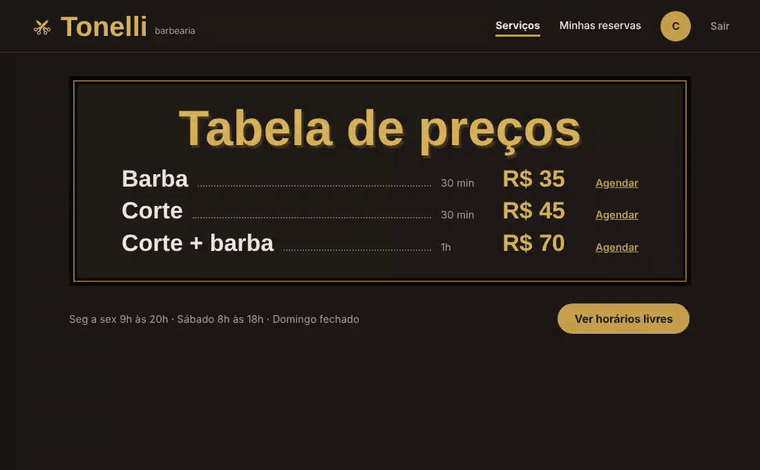
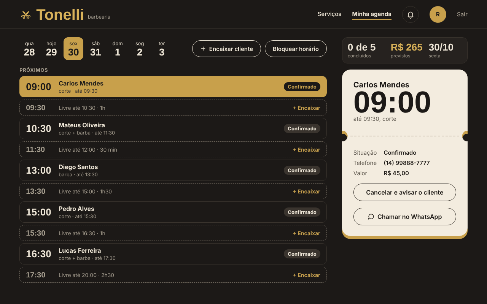
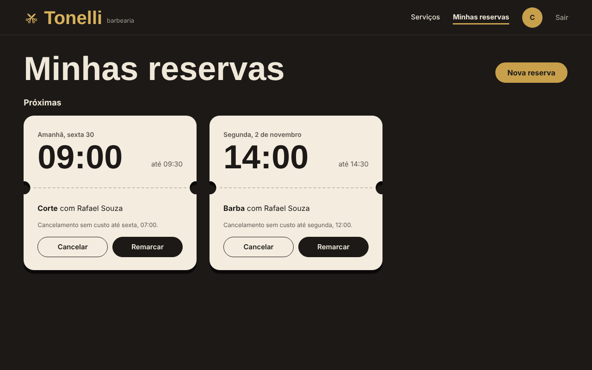
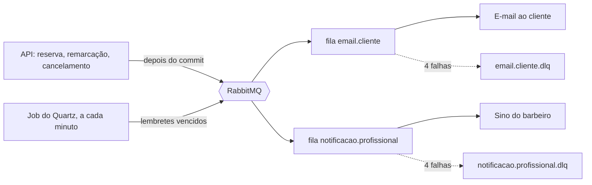
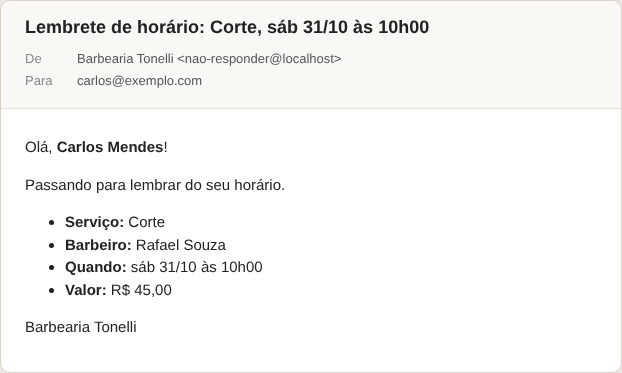

# Sistema de Agendamento

[](https://github.com/Guilherme-Tonellidev/sistema-agendamento/actions/workflows/backend-ci.yml)
[](https://github.com/Guilherme-Tonellidev/sistema-agendamento/actions/workflows/frontend-ci.yml)

Agendamento de horários para uma barbearia. O cliente reserva, o barbeiro cuida da agenda e o banco de
dados garante que nunca existam dois agendamentos sobrepostos para o mesmo profissional.



| Agenda do barbeiro | Minhas reservas |
| --- | --- |
|  |  |

## O que faz

- Calcula os horários livres de cada barbeiro a partir da jornada semanal, das folgas e das reservas ativas.
- O cliente reserva (com 1h30 de antecedência), remarca e cancela (até 2 h antes). O barbeiro encaixa quem chega sem reserva, bloqueia horários e conclui atendimentos. O administrador cuida do catálogo e do acesso dos barbeiros.
- Avisa por e-mail (comprovante, remarcação, cancelamento e lembrete) e, para o barbeiro, pelo sino do cabeçalho.
- Manda um lembrete 24 h antes do horário, ou 1 h antes para quem reservou com menos de 24 h.

## Stack

| Camada | Tecnologias |
| --- | --- |
| Back-end | Java 21, Spring Boot 4, Spring Security (JWT), Spring Data JPA, MapStruct, Flyway, OpenAPI (Swagger UI) |
| Banco de dados | PostgreSQL 18 |
| Mensageria e agendador | RabbitMQ, Quartz (armazenamento JDBC), Spring Mail (Mailpit em desenvolvimento) |
| Front-end | Angular 22 (signals, sem zone.js), Vitest |
| Testes | JUnit, AssertJ, Testcontainers (PostgreSQL, RabbitMQ, Redis e Mailpit reais) |
| Entrega | Docker, GitHub Actions |

## Como rodar

Pré-requisitos: JDK 21, Docker Desktop e, para o front-end, Node.js 24.

Opção 1, a mais simples. O Testcontainers sobe PostgreSQL, RabbitMQ, Redis e Mailpit sozinho, em portas sorteadas:

```bash
cd backend
./mvnw spring-boot:test-run
```

Opção 2, com endereços fixos (Docker Compose):

```bash
docker compose up -d --wait
cd backend
./mvnw spring-boot:run
```

Os dois comandos ativam o perfil `local`: chave JWT sorteada a cada subida, conta de administrador e dados de exemplo.
Sem perfil ativo a aplicação não usa nenhum valor de desenvolvimento e exige as variáveis de ambiente da seção de deploy
em [`docs/referencia.md`](docs/referencia.md). Para rodar o jar direto, use `--spring.profiles.active=local`.

Front-end, com a API no ar:

```bash
cd frontend
npm install
npm start
```

Mais detalhes em [`frontend/README.md`](frontend/README.md).

| Serviço | Endereço |
| --- | --- |
| Front-end | <http://localhost:4200> |
| API e Swagger UI | <http://localhost:8080/swagger-ui.html> |
| Caixa de e-mails (Mailpit, opção 2) | <http://localhost:8025> |
| RabbitMQ (opção 2) | <http://localhost:15672> (`guest` / `guest`) |

### Dados de exemplo

Em desenvolvimento, a primeira subida com o banco vazio cadastra 3 serviços, 2 barbeiros com jornada e estas contas. Em produção nada disso é cadastrado. Para recomeçar com o banco vazio na opção 2, use `docker compose down -v`.

| Papel | E-mail | Senha |
| --- | --- | --- |
| Administrador | `admin@agendamento.local` | `admin-local-123` |
| Barbeiro | `rafael@tonelli.local` | `barbeiro-local-123` |
| Cliente | `carlos@tonelli.local` | `cliente-local-123` |

### Testes

```bash
cd backend && ./mvnw verify
cd frontend && npm test
```

No Windows, use `mvnw.cmd` no lugar de `./mvnw` se não estiver no Git Bash.

## Como funciona



- O evento só vai para o RabbitMQ depois do commit da reserva, então nenhum e-mail sai para uma reserva desfeita. Se o broker estiver fora nesse instante, a reserva continua valendo e o aviso daquela vez se perde (o erro fica no log).
- Cada fila tem seu consumidor, então uma falha do SMTP não atrasa o sino. Cada mensagem é tentada 4 vezes (2 s, 6 s e 18 s de espera) e depois vai para a `.dlq`, de onde só se reprocessa à mão, pelo painel do RabbitMQ.
- A entrega é "pelo menos uma vez": uma queda entre o envio e a confirmação pode repetir um e-mail.
- Cada agendamento guarda quando deve ser lembrado. O job do Quartz publica os lembretes vencidos e só marca o envio depois que o broker confirma. Remarcar ou cancelar só muda essas colunas.



## Segurança

- Login com token de acesso JWT de 15 min, guardado só em memória no front, e refresh token num cookie `HttpOnly` com `SameSite=Strict`.
- Cada renovação troca o refresh token. Se um token já trocado aparecer de novo, todas as sessões daquela família são revogadas.
- No banco ficam só hashes: BCrypt nas senhas e SHA-256 nos refresh tokens.
- O login aceita 5 tentativas por janela de 15 minutos para cada par e-mail + origem; a seguinte recebe `429` com `Retry-After`. A contagem fica no Redis e vale entre instâncias; com o Redis fora do ar, o login segue e cada instância conta por conta própria, na memória.
- Login inválido tem sempre a mesma mensagem e o mesmo tempo de resposta. Agendamento de outra pessoa responde `404`.
- Toda rota exige login, exceto as públicas. As regras de dono ficam nos services, com testes para cada papel.

## Decisões técnicas

- Schema versionado com Flyway. O Hibernate só valida (`ddl-auto: validate`).
- Conflito de horários garantido pelo banco: constraints de exclusão com `btree_gist`, testadas com requisições simultâneas.
- Uma trava por agenda (`SELECT ... FOR UPDATE`) impede que uma reserva e um bloqueio simultâneos passem cada um pela sua checagem (*write skew*).
- Concorrência otimista: cada registro tem versão, e quem edita depois recebe `409`.
- Datas em UTC e hora vinda de um `Clock` injetado, para testar regras de horário com datas fixas.
- O preço fica congelado na reserva. Serviços e profissionais são inativados, não apagados.
- Erros no padrão Problem Details (RFC 9457), com `404`, `409` e `422`.
- Quartz no PostgreSQL, em cluster: com duas instâncias da API, só uma varre por vez.
- Testes com PostgreSQL, RabbitMQ, Redis e Mailpit reais (Testcontainers), sem H2.

Endpoints, regras de reserva, avisos, configuração e deploy: [`docs/referencia.md`](docs/referencia.md).

## Roadmap

- [x] **0. Esqueleto:** Spring Boot, Flyway, Testcontainers, Docker e CI
- [x] **1. Cadastros:** profissionais, serviços e clientes
- [x] **2. Disponibilidade:** horários de trabalho, folgas e horários livres
- [x] **3. Reserva:** criação, cancelamento, reagendamento e conflito de horários
- [x] **4. Segurança:** JWT com papéis, refresh token com rotação e regras por dono
- [ ] **4b. Login com Google**
- [x] **5. Angular:** base, login e rotas protegidas
- [x] **6. Telas do front-end:** serviços, minhas reservas e agenda do barbeiro com encaixe e bloqueio
- [x] **7. RabbitMQ:** eventos de agendamento, e-mails ao cliente e sino de notificações do barbeiro
- [x] **8. Quartz:** lembretes por e-mail 24h antes do horário (1h antes para quem reserva em cima da hora)
- [ ] **9. Redis:** cache de horários e limite de tentativas de login
- [ ] **10. Painel do administrador:** visão da semana com FullCalendar e histórico com Hibernate Envers
- [ ] **11. Deploy** com link público

## Autor

Guilherme Tonelli · [LinkedIn](https://www.linkedin.com/in/guilherme-tonellidev) · [GitHub](https://github.com/Guilherme-Tonellidev)
